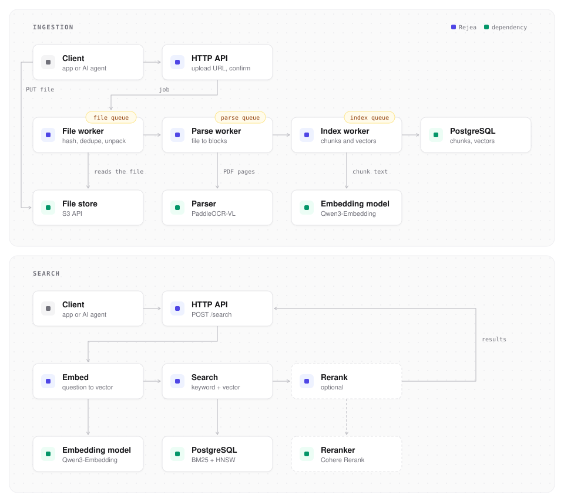

```text
██████╗ ███████╗     ██╗███████╗ █████╗
██╔══██╗██╔════╝     ██║██╔════╝██╔══██╗
██████╔╝█████╗       ██║█████╗  ███████║
██╔══██╗██╔══╝  ██   ██║██╔══╝  ██╔══██║
██║  ██║███████╗╚█████╔╝███████╗██║  ██║
╚═╝  ╚═╝╚══════╝ ╚════╝ ╚══════╝╚═╝  ╚═╝
```

# Rejea

Rejea is a document retrieval engine. It ingests PDF, Word and Markdown files, indexes them in PostgreSQL, and serves hybrid search (BM25 and vector) through an HTTP API.

It is the retrieval stage of a RAG system: an application or an AI agent sends a question, and gets the chunks that hold the answer, each with its document, heading path and pages.

| Feature | Detail |
| --- | --- |
| Ingestion | Presigned upload URLs. Single files and archives (zip, tar, tar.gz). Duplicate check by SHA-256. Each stage runs again after a fault. |
| PDF | Layout-aware OCR (PaddleOCR-VL-1.6): headings, paragraphs, tables, lists and figures, each with its bounding box. |
| Word, Markdown | `.docx`, `.doc`, `.md`, `.markdown`. |
| Chunking | Cut at headings. Each chunk starts with its heading path. |
| Search | BM25 (`pg_textsearch`) and HNSW vectors (`pgvector`), merged by reciprocal rank fusion. Filters by document and by metadata. |
| Reranker | Optional. Cohere, Amazon Bedrock or Cloudflare. |

Measured on 400 questions over 219 finance and legal PDFs: 80.3% of the answer pages are in the first 5 results, and 83.2% with the reranker. See [search quality](docs/search-quality.md).

## Quick start

| Requirement | Needed for |
| --- | --- |
| Docker with Compose, and `make` | All parts |
| A Mac with Apple Silicon, and Python 3.12 | The PDF parser |
| A Cloudflare account (free) | The embedding model |
| 8 GB of free disk | The first start |

1. Get the code and the settings file.

   ```sh
   git clone https://github.com/Njunge11/rejea.git
   cd rejea
   cp .env.example .env
   ```

2. Put your Cloudflare API token and account ID in `.env`. [Where to get them](#embeddings).

   ```sh
   REJEA_EMBED_API_KEY=<the API token>
   REJEA_EMBED_API_URL=https://api.cloudflare.com/client/v4/accounts/<the account ID>/ai/run
   ```

3. Start Rejea.

   ```sh
   make up
   ```

The service is at `http://localhost:8080`. The first start takes 5 to 20 minutes for the downloads, and a later start takes 30 seconds. `make up` names each thing that is missing, with its correction. `make down` stops Rejea, and the data stays.

## Use

Upload a document:

```sh
# 1. Ask for an upload URL. The size is in bytes. The metadata is optional.
curl -s http://localhost:8080/documents \
  -H 'Content-Type: application/json' \
  -d '{"files": [{"filename": "report.pdf", "size": 482113, "metadata": {"department": "finance"}}]}'

# 2. Send the file to the "upload_url" of the answer.
curl -s -X PUT --upload-file report.pdf "<upload_url>"

# 3. Confirm the upload. The ingestion starts.
curl -s -X POST http://localhost:8080/documents/<id>/confirm

# 4. Read the status. A document is ready when its status is "indexed".
curl -s http://localhost:8080/documents/<id>
```

Search:

```sh
curl -s http://localhost:8080/search \
  -H 'Content-Type: application/json' \
  -d '{"query": "What was the overall inflation rate in April 2011?", "limit": 1}'
```

```json
{
  "results": [
    {
      "chunk_id": "01a20e3d-05ab-78aa-87b3-c63c6b8628dc",
      "document": { "id": "01a20e10-5d4b-71d4-80a6-306d539111bc", "filename": "cpi-a.pdf", "title": null },
      "page_start": 1,
      "page_end": 3,
      "heading_path": ["CPI AND INFLATION RATES FOR THE MONTH OF APRIL 2011"],
      "text": "CPI AND INFLATION RATES FOR THE MONTH OF APRIL 2011\n\nKenya National Bureau of Statistics hereby ...",
      "block_ids": ["01a20e11-0e87-7256-bd54-63ee78dc598d"],
      "score": 0.03279,
      "rerank_score": null,
      "keyword_rank": 1,
      "vector_rank": 1
    }
  ]
}
```

| Search field | Value |
| --- | --- |
| `query` | The question. Necessary. |
| `limit` | The number of results. Default 10, largest 50. |
| `filters.document_ids` | Search in these documents only. |
| `filters.metadata` | Search in the documents with this metadata, for example `{"department": "finance"}`. |
| `rerank` | `true` or `false`. Default: the setting `REJEA_RERANK`. |

| Endpoint | What it does |
| --- | --- |
| `POST /documents` | Makes a document for each file and gives its upload URL. |
| `POST /documents/{id}/confirm` | Starts the ingestion. |
| `GET /documents/{id}` | Gives the status: `uploading`, `uploaded`, `unpacked`, `parsing`, `indexing`, `indexed`, `duplicate` or `failed`. |
| `GET /documents` | Lists the documents. Parameters: `status`, `limit`, `starting_after`. |
| `POST /documents/{id}/retry` | Starts a failed document again. |
| `GET /documents/{id}/pages` | Lists the page images of a PDF. Parameters: `limit`, `starting_after`. |
| `POST /search` | Searches the indexed documents. |
| `GET /healthz` | Answers `ok`. |

## Architecture



| Component | Technology |
| --- | --- |
| Service: HTTP API and three workers | Go |
| Job queues | [River](https://riverqueue.com), in PostgreSQL |
| Database | PostgreSQL 17, `pgvector`, `pg_textsearch` |
| File store | [SeaweedFS](https://github.com/seaweedfs/seaweedfs), or AWS S3 |
| Parser | PaddleOCR-VL-1.6 on MLX. It runs outside Docker: a container gets no GPU on a Mac. |
| Word and Markdown readers | [office_oxide](https://github.com/yfedoseev/office_oxide), [goldmark](https://github.com/yuin/goldmark) |
| Embedding model | Qwen3-Embedding-0.6B on Cloudflare Workers AI, 1,024 dimensions |
| Reranker | Cohere Rerank, direct or on Amazon Bedrock |

More detail: [file formats, chunks and the index](docs/formats.md).

## Settings

All settings are in [.env.example](.env.example), each with its default. A setting with no value uses its default.

| Setting | Default | What it is |
| --- | --- | --- |
| `REJEA_EMBED_API_KEY` | none | The API key of the embedding model. |
| `REJEA_EMBED_API_URL` | none | The API address of the embedding model. |
| `REJEA_RERANK` | `false` | `true`: each search uses the reranker. |
| `REJEA_RERANK_PROVIDER` | `cloudflare` | `bedrock`, `cloudflare` or `cohere`. |
| `REJEA_RERANK_API_KEY` | none | The API key of the reranker. |
| `REJEA_PARSER_URL` | none | No value: the parser of this Mac. An address: a parser on another machine. |
| `REJEA_PORT` | `8080` | The port of the service. |
| `REJEA_PARSE_WORKERS` | `1` | The number of parse jobs at the same time. |
| `REJEA_CHUNK_MAX_TOKENS` | `1024` | The largest chunk. After a change, run `make reindex`. |

### Embeddings

1. Make an account at [dash.cloudflare.com](https://dash.cloudflare.com/sign-up).
2. In the dashboard, open **AI**, then **Workers AI**, then **REST API**.
3. Make a Workers AI API token. Copy the token and the account ID.

### Reranker

| Provider | Default model | The key | Cost |
| --- | --- | --- | --- |
| `cohere` | `rerank-v5.0-fast` | From [dashboard.cohere.com/api-keys](https://dashboard.cohere.com/api-keys). A trial key is free. | 0.02 US dollars for one million tokens |
| `bedrock` | `cohere.rerank-v3-5:0` | An Amazon Bedrock API key | 0.002 US dollars for a search |
| `cloudflare` | `@cf/baai/bge-reranker-base` | The key and the address of the embedding model | The neurons of the account |

```sh
REJEA_RERANK_PROVIDER=cohere
REJEA_RERANK_API_KEY=<the API key>
REJEA_RERANK=true
```

Use `cohere` or `bedrock`: the model of `cloudflare` made the search worse in the measurement. For `bedrock` in a different AWS Region, set `REJEA_RERANK_API_URL`.

### File storage

`make up` uses SeaweedFS in a container. For a bucket in AWS S3, with or without CloudFront: [file storage in AWS](docs/aws-storage.md).

## Develop

Needs Go 1.26, a C compiler, golangci-lint and Lefthook.

```sh
lefthook install         # Git hooks
make tokenizer-install   # the tokenizer of the embedding model
make word-install        # the Word reader
make db-up               # the database and the file store
make migrate
make serve               # the service, outside Docker
make parser              # the parser, in a second terminal
make check               # lint, vet, build, tests
```

Use the `make` commands, not the bare `go` commands. Commit messages follow [Conventional Commits](https://www.conventionalcommits.org).

## To do

- [ ] **Parser on Linux and Windows.** The PDF parser runs only on a Mac with Apple Silicon, or on a GPU machine that you give in `REJEA_PARSER_URL`.
- [ ] **Authentication.** The API has none: put it behind your own gateway.
- [ ] **Delete a document.** The API has no endpoint for it.
- [ ] **Deployment.** Make Rejea easy to deploy on a server.
- [ ] **Automated tests.** Add regression tests as the code grows. Today, each change is proved by a run through the service. Formal verification is an option to examine.
- [ ] **Larger measurements.** Measure the search with more documents and more questions.
- [ ] **Performance.** Make the ingestion and the search faster.

## License

[MIT](LICENSE)
