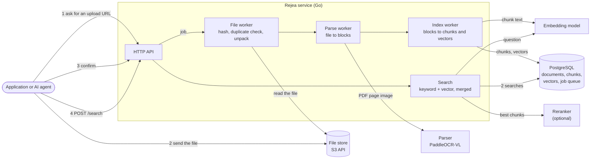

```text
██████╗ ███████╗     ██╗███████╗ █████╗
██╔══██╗██╔════╝     ██║██╔════╝██╔══██╗
██████╔╝█████╗       ██║█████╗  ███████║
██╔══██╗██╔══╝  ██   ██║██╔══╝  ██╔══██║
██║  ██║███████╗╚█████╔╝███████╗██║  ██║
╚═╝  ╚═╝╚══════╝ ╚════╝ ╚══════╝╚═╝  ╚═╝
```

# Rejea

Rejea is a document retrieval engine. It ingests PDF, Word and Markdown files, indexes them in PostgreSQL, and serves hybrid search (BM25 and vector) through an HTTP API.

It is the retrieval stage of a RAG system. An application or an AI agent sends a question to `POST /search` and gets the chunks that most probably hold the answer, each with its document, its heading path and its pages. The application writes the answer and cites those sources.

## Features

| Feature | What Rejea does |
| --- | --- |
| Ingestion | Upload through presigned URLs: one file, or an archive (zip, tar, tar.gz). A SHA-256 hash finds duplicates. Each job stage runs again after a fault. |
| PDF | Layout-aware OCR with PaddleOCR-VL-1.6. Each page becomes blocks (heading, paragraph, table, list, figure), each with its bounding box. |
| Word | `.docx` and `.doc`, read with [office_oxide](https://github.com/yfedoseev/office_oxide). |
| Markdown | `.md` and `.markdown`, read with [goldmark](https://github.com/yuin/goldmark): CommonMark with the GitHub additions. |
| Chunking | Chunks are cut at headings, and each chunk starts with its heading path. A large table is split at its rows, and each part keeps the header rows. |
| Hybrid search | Keyword search (BM25, `pg_textsearch`) and vector search (HNSW, `pgvector`), merged by reciprocal rank fusion. |
| Reranker | Optional second stage with a cross-encoder model: Cohere, Amazon Bedrock or Cloudflare. |
| Filters | Search in a set of documents, or in the documents with given metadata. |
| Sources | Each result has its document, pages, heading path and block IDs. An endpoint gives the page images for a viewer. |
| Providers | A change of model provider is a change of settings, not of code. |

## Search quality

| Test | Measure | No reranker | With reranker |
| --- | --- | --- | --- |
| 400 questions on 219 finance and legal PDFs (3,121 pages, from UniDoc-Bench) | Share of the answer pages in the first 5 results | 80.3% | 83.2% |
| 42 questions on 13 statistics reports (the test set of this repo) | Questions with a correct page in the first 5 results | 40 of 42 | 42 of 42 |

The method and all numbers: [search quality](docs/search-quality.md) and [the reranker and graph experiment](docs/experiments/reranker-and-graph.md).

## Limits

- The PDF parser runs on a Mac with Apple Silicon, or on a GPU machine that you give in `REJEA_PARSER_URL`. On Linux with no parser, Word and Markdown files go through, and a PDF waits. Windows is not supported.
- The API has no authentication. Put it behind your own gateway.
- The API has no endpoint to delete a document.

## Set up

| Requirement | Needed for | Notes |
| --- | --- | --- |
| Docker with Compose | The database, the file store and the service | |
| `make` | Each command | |
| A Mac with Apple Silicon, and Python 3.12 | The PDF parser | The parser uses 3 GB of memory. A page takes 3 to 40 seconds on an M2 Pro. |
| A Cloudflare account | The embedding model | Free: 10,000 neurons each day, about 9 million tokens. |
| 8 GB of free disk | The first start | It downloads 0.8 GB of container images and, on a Mac, the parser (2.2 GB) and its models (2 GB). |

```sh
git clone https://github.com/Njunge11/rejea.git
cd rejea
cp .env.example .env
```

Put the two values of the embedding model in `.env` (see [Embeddings](#embeddings)):

```sh
REJEA_EMBED_API_KEY=<the API token>
REJEA_EMBED_API_URL=https://api.cloudflare.com/client/v4/accounts/<the account ID>/ai/run
```

Start Rejea:

```sh
make up
```

`make up` names each thing that is missing on the machine, with its correction, and then starts all parts. The first start takes 5 to 20 minutes for the downloads. A later start takes 30 seconds.

The service is at `http://localhost:8080`, and `GET /healthz` answers `ok`.

| Command | What it does |
| --- | --- |
| `make up` | Starts the database, the file store and the service in containers, and the parser on the Mac. |
| `make down` | Stops all of it. The data stays in two Docker volumes. |
| `make reindex` | Makes the chunks and the vectors of each document again, with no new parse. Use it after a change of the chunk size or of the embedding model. |
| `make search-report` | Measures the search with the test set and compares it with the saved report. |

## Use

### Upload a document

```sh
# 1. Ask for an upload URL. The size is in bytes. The metadata is optional.
curl -s http://localhost:8080/documents \
  -H 'Content-Type: application/json' \
  -d '{"files": [{"filename": "report.pdf", "size": 482113, "metadata": {"department": "finance"}}]}'

# 2. Send the file to the "upload_url" of the answer.
curl -s -X PUT --upload-file report.pdf "<upload_url>"

# 3. Confirm the upload. The ingestion starts.
curl -s -X POST http://localhost:8080/documents/<id>/confirm

# 4. Read the status.
curl -s http://localhost:8080/documents/<id>
```

A document goes through these statuses: `uploading`, `uploaded`, `parsing`, `indexing`, `indexed`. An archive gets `unpacked`, and each file in it becomes a document. A file that is already there gets `duplicate`. A document that cannot be read gets `failed`, with the reason in `error`.

### Search

```sh
curl -s http://localhost:8080/search \
  -H 'Content-Type: application/json' \
  -d '{"query": "What was the overall inflation rate in April 2011?", "limit": 1}'
```

```json
{
  "results": [
    {
      "chunk_id": "01a20e3d-05ab-78aa-87b3-c63c6b8628dc",
      "document": { "id": "01a20e10-5d4b-71d4-80a6-306d539111bc", "filename": "cpi-a.pdf", "title": null },
      "page_start": 1,
      "page_end": 3,
      "heading_path": ["CPI AND INFLATION RATES FOR THE MONTH OF APRIL 2011"],
      "text": "CPI AND INFLATION RATES FOR THE MONTH OF APRIL 2011\n\nKenya National Bureau of Statistics hereby ...",
      "block_ids": ["01a20e11-0e87-7256-bd54-63ee78dc598d", "01a20e11-0e87-725b-84c5-d9714f94e008"],
      "score": 0.03279,
      "rerank_score": null,
      "keyword_rank": 1,
      "vector_rank": 1
    }
  ]
}
```

| Request field | Value |
| --- | --- |
| `query` | The question. Necessary. |
| `limit` | The largest number of results. Default 10, largest 50. |
| `filters.document_ids` | Search in these documents only. |
| `filters.metadata` | Search in the documents whose metadata has each name and value, for example `{"department": "finance"}`. |
| `rerank` | `true` or `false`: use the reranker for this search. Default: the setting `REJEA_RERANK`. |

- `score` puts the results in order. It does not tell how good a result is.
- The vector search always gives its nearest chunks, so a question with no answer in the documents also gets results.
- A Word file and a Markdown file have no pages: `page_start` and `page_end` are `null`.

### Endpoints

| Endpoint | What it does |
| --- | --- |
| `POST /documents` | Makes a document for each file and gives its upload URL. |
| `POST /documents/{id}/confirm` | Confirms the upload and starts the ingestion. |
| `GET /documents/{id}` | Gives the status of one document. |
| `GET /documents` | Lists the documents. Parameters: `status`, `limit`, `starting_after`. |
| `POST /documents/{id}/retry` | Starts a failed document again. It skips the stages that are complete. |
| `GET /documents/{id}/pages` | Lists the page images of a PDF, each with its size and a URL. Parameters: `limit`, `starting_after`. |
| `POST /search` | Searches the indexed documents. |
| `GET /healthz` | Tells that the service and its database answer. |

## Architecture



**Ingestion.** The client sends the file directly to the file store, then confirms. Three workers then do the work in order, each from its own job queue. A stage that fails runs again, and a stage that is complete does not run again.

**Search.** The embedding model turns the question into a vector. The database runs the keyword search and the vector search, and the service merges the two lists. The reranker, if it is on, puts the best chunks in a better order.

| Component | What it does |
| --- | --- |
| HTTP API | Makes upload URLs, and gives statuses, page images and search results. |
| File worker | Reads the file from the store, makes its SHA-256 hash, finds a duplicate, and unpacks an archive. |
| Parse worker | Turns a file into blocks. For a PDF, it renders each page and sends the image to the parser. It reads Word and Markdown files itself. |
| Index worker | Cuts the blocks into chunks, gets the vector of each chunk, and saves them in one transaction. |
| Job queue | [River](https://riverqueue.com), in PostgreSQL. It holds the jobs of the three workers, with their new attempts. |
| Parser | PaddleOCR-VL-1.6 on MLX. It reads a page image and gives the blocks with their boxes. It runs outside Docker, because a container gets no GPU on a Mac. |
| Database | PostgreSQL 17 with `pgvector` and `pg_textsearch`. It holds the documents, the blocks, the chunks with their vectors, and the job queue. It runs the two searches. |
| File store | [SeaweedFS](https://github.com/seaweedfs/seaweedfs), or AWS S3. It holds the uploaded files and the page images. |
| Embedding model | Qwen3-Embedding-0.6B on Cloudflare Workers AI. It turns a chunk or a question into a vector of 1,024 numbers. |
| Reranker | Cohere Rerank, direct or on Amazon Bedrock. It reads the question with each chunk and gives a score. |

More detail: [file formats, chunks and the index](docs/formats.md).

## Settings

All settings are in [.env.example](.env.example), each with its default. Copy the file to `.env` and change the values there. A setting with no value uses its default.

| Section of the file | Settings |
| --- | --- |
| 1. Models | The provider, the model, the API key and the API address of the embedding model and of the reranker. |
| 2. Parser | The address of the parser. |
| 3. `make up` | The ports of this machine, and the keys of the local file store. |
| 4. `make serve` only | The database, the file store and the paths, for a service that runs outside Docker. `make up` does not read this section. |
| 5. Speed | The number of jobs at the same time. |
| 6. Logs | The level and the format. |
| 7. Limits | The limits of sizes, numbers and times. |

The settings that most installations change:

| Setting | Default | What it is |
| --- | --- | --- |
| `REJEA_EMBED_API_KEY` | none | The API key of the embedding model. |
| `REJEA_EMBED_API_URL` | none | The API address of the embedding model. |
| `REJEA_RERANK_PROVIDER` | `cloudflare` | `bedrock`, `cloudflare` or `cohere`. |
| `REJEA_RERANK_API_KEY` | none | The API key of the reranker. |
| `REJEA_RERANK` | `false` | `true`: each search uses the reranker. |
| `REJEA_PARSER_URL` | none | No value: the parser of this Mac. An address: a parser on another machine. |
| `REJEA_PORT` | `8080` | The port of the service on this machine. |
| `REJEA_PARSE_WORKERS` | `1` | The number of parse jobs at the same time. |
| `REJEA_CHUNK_MAX_TOKENS` | `1024` | The largest chunk, in tokens. After a change, run `make reindex`. |

### Embeddings

The default is Qwen3-Embedding-0.6B on [Cloudflare Workers AI](https://developers.cloudflare.com/workers-ai/).

1. Make an account at [dash.cloudflare.com](https://dash.cloudflare.com/sign-up).
2. In the dashboard, open **AI**, then **Workers AI**, then **REST API**.
3. Make a Workers AI API token, and copy the token and the account ID.
4. Put the token in `REJEA_EMBED_API_KEY`, and the account ID in the address of `REJEA_EMBED_API_URL`.

When the service starts, it sends one small request to the model. With a wrong value, it stops and names the setting to correct. With no values, it starts and warns: a document is parsed, and its index stage fails with the correction as its reason.

### Reranker

The reranker is off by default. `REJEA_RERANK=true` turns it on for each search, and the field `rerank` of a request turns it on or off for one search.

| Provider | Default model | The key | Cost |
| --- | --- | --- | --- |
| `cohere` | `rerank-v5.0-fast` | An API key from [dashboard.cohere.com/api-keys](https://dashboard.cohere.com/api-keys). A trial key is free: 1,000 calls each month, 10 each minute. | 0.02 US dollars for one million tokens |
| `bedrock` | `cohere.rerank-v3-5:0` | An Amazon Bedrock API key of your AWS account. | 0.002 US dollars for a search |
| `cloudflare` | `@cf/baai/bge-reranker-base` | The key and the address of the embedding model. | It uses the neurons of the Cloudflare account |

```sh
REJEA_RERANK_PROVIDER=cohere
REJEA_RERANK_API_KEY=<the API key>
REJEA_RERANK=true
```

- Use `cohere` or `bedrock`. The model of `cloudflare` reads only 512 tokens of a chunk, and it made the search worse in the measurement.
- The address of `bedrock` has the AWS Region of the model. For a different Region: `REJEA_RERANK_API_URL=https://bedrock-runtime.us-west-2.amazonaws.com`.
- `REJEA_RERANK_MODEL` selects a different model of the provider.

### Parser

With no value in `REJEA_PARSER_URL`, `make up` starts the parser on this Mac and uses it. For a parser on another machine, such as a GPU machine in the cloud, give its address: `make up` then starts no parser here. The [parse speed experiment](docs/experiments/parse-speed.md) used a GPU machine in AWS in this way.

### File storage

`make up` starts SeaweedFS in a container, with the bucket `rejea`. Its two keys are `REJEA_STORAGE_ACCESS_KEY` and `REJEA_STORAGE_SECRET_KEY`. Change them before another machine can reach the store.

For a bucket in AWS S3, with or without CloudFront in front of it for the page images: [file storage in AWS](docs/aws-storage.md).

## Develop

To change the code, run the service on the machine itself. This needs Go 1.26, a C compiler, golangci-lint and Lefthook.

```sh
lefthook install         # hooks: lint before a commit, check of the commit message
cp .env.example .env
make tokenizer-install   # the tokenizers library and the tokenizer of the embedding model, 50 MB
make word-install        # the Word reader, 4 MB
make db-up               # the database and the file store, in containers
make migrate
make serve               # http://127.0.0.1:8080/healthz
make parser              # the parser, in a second terminal
make check               # lint, vet, build, tests, Docker checks, the question file
```

- Use `make build`, `make serve` and `make test`, not the bare `go` commands: they tell the Go compiler where the tokenizers library is.
- Commit messages follow [Conventional Commits](https://www.conventionalcommits.org). A Git hook and CI check each message.

## To do

- **Deployment:** make Rejea easy to deploy on a server.
- **Automated tests:** add regression tests as the code grows. Today, each change is proved by a run through the service. Formal verification is an option to examine.
- **Larger measurements:** measure the search with more documents and more questions.
- **Performance:** make the ingestion and the search faster.

## License

[MIT](LICENSE)
